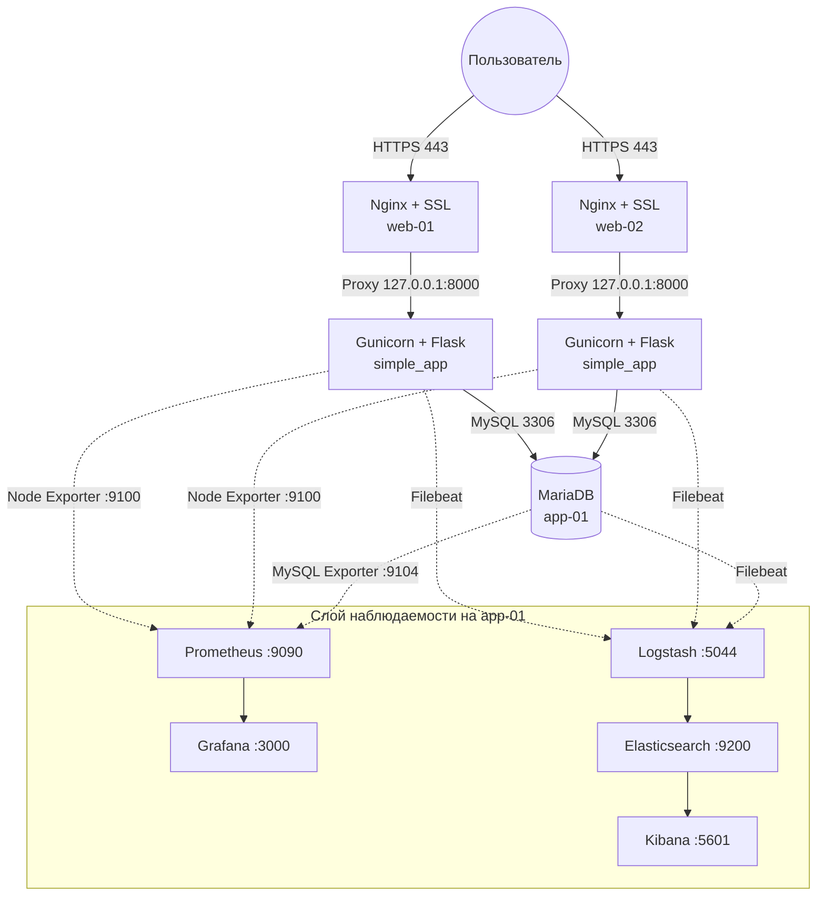

````markdown
# 🚀 Ansible SRE Lab 01: Production-Ready Infrastructure as Code

[](https://www.ansible.com/)
[](https://www.python.org/)
[](https://grafana.com/)
[](https://www.elastic.co/)

Полноценный лабораторный проект по автоматизации инфраструктуры, демонстрирующий подходы **Site Reliability Engineering (SRE)** и **DevOps**. Проект охватывает полный цикл: от первичной харденинг-настройки серверов до развёртывания отказоустойчивого веб-стека и настройки полноценной наблюдаемости (Observability).

> 📂 **Репозиторий:** [github.com/heltoe/ansible/tree/master/lab-01](https://github.com/heltoe/ansible/tree/master/lab-01)

---

## 🏗 Архитектура проекта

Проект реализует классическую трёхзвенную архитектуру с выделенным слоем наблюдаемости:


````

---

# 🛠 Технологический стек

* Automation (Ansible, Jinja2, YAML, Bash)
* Web / App (Nginx (Reverse Proxy), Gunicorn (WSGI), Python 3, Flask)
* Database (MariaDB 11.x)
* Monitoring (Prometheus, Grafana, Node Exporter, MySQL Exporter)
* Logging (ELK Stack (Elasticsearch, Logstash, Kibana, Filebeat))
* OS / Security (Ubuntu 22.04 LTS, UFW, Fail2ban, Self-signed SSL/TLS)

---

# 📚 Этапы выполнения (Модули)

## 🔹 Модуль 1.1: Initial Server Setup

* Настройка бесключевого SSH-доступа и харденинг (```PermitRootLogin no```, ```PasswordAuthentication no```).
* Создание привилегированных пользователей через ```sudoers```.
* Настройка брандмауэра (UFW) и защиты от brute-force (Fail2ban).
* Синхронизация времени (Chrony) и обновление системы.
* Использование ролей Ansible и идемпотентных модулей (```user```, ```lineinfile```, ```ufw```).

## 🔹 Модуль 1.2: Patch Management & Rolling Updates

* Реализация стратегии Rolling Update (```serial: 1```) для обновления пакетов без простоя сервиса.
* Pre-checks (проверка места на диске) и Post-checks (проверка load average).
* Автоматические Health-checks (```ansible.builtin.uri```) после каждого обновления.
* Механизм отката (Rollback) при неудачной проверке работоспособности.

## 🔹 Модуль 1.3: Full Stack Deployment (Web + DB)

* Разделение ролей: ```app_servers``` (web-01, web-02) и ```db_servers``` (app-01).
* Развёртывание **MariaDB** с безопасной инициализацией и созданием выделенных пользователей.
* Деплой Python-приложения (Flask) через **Gunicorn** (4 workers × 2 threads) в виртуальном окружении (```venv```).
* Настройка **Nginx** как Reverse Proxy с корректной передачей заголовков (```proxy_set_header Host $host```) и самоподписанными SSL-сертификатами.

## 🔹 Модуль 1.4: Monitoring Stack (Prometheus + Grafana)

* Установка **Node Exporter** на все узлы для сбора метрик ОС (CPU, RAM, Disk, Network).
* Установка **MySQL Exporter** на сервер базы данных.
* Развёртывание **Prometheus** с динамическим ```scrape_config```.
* Установка **Grafana** и импорт production-дашборда (ID: 1860) для визуализации метрик.

---

# 💻 Prerequisites (Требования к среде)
Для воспроизведения среды потребуется:
1. **Хост-машина:** Linux (WSL2) или macOS с установленным Ansible (>= 2.14).
2. **VirtualBox / VMware:** 3 виртуальные машины с Ubuntu 22.04 LTS.
* ```web-01```: 2 vCPU, 2GB RAM, 20GB Disk (IP: ```192.168.1.10```)
* ```web-02```: 2 vCPU, 2GB RAM, 20GB Disk (IP: ```192.168.1.11```)
* ```app-01```: 2 vCPU, 4-6GB RAM, 30GB+ Disk (IP: ```192.168.1.12```) (ELK требователен к ресурсам).
3. Сетевой мост (Host-Only или Internal Network) для связи между хостом и ВМ.

---

# 🚀 Быстрый старт (Deployment).

1. Клонируйте репозиторий и настройте инвентарь:

```bash
   git clone https://github.com/heltoe/ansible.git
   cd ansible/lab-01
   # Отредактируйте inventory/production/hosts.yml под ваши IP-адреса
```

2. Проверьте подключение:

```bash
   ansible all -m ping
```

3. Запустите пайплайн развёртывания:

```bash
   # 1. Базовая настройка и харденинг
   ansible-playbook playbooks/01-initial-setup.yml
   
   # 2. Развёртывание полного стека (DB + Web + SSL)
   ansible-playbook playbooks/05-install-app.yml
   
   # 3. Развёртывание мониторинга
   ansible-playbook playbooks/6-deploy-monitoring.yml
   
   # 4. Развёртывание централизованного логирования
   ansible-playbook playbooks/07-deploy-elk.yml
```

---

# 🔍 Key Troubleshooting & Lessons Learned

В ходе реализации проекта были решены следующие нетривиальные задачи:

1. Nginx 301 Redirect Loop:

Добавлен ```proxy_set_header Host $host;``` во все ```location``` блоки и явное указание порта в upstream (```127.0.0.1:8000```), чтобы Flask генерировал корректные абсолютные URL.

2. Gunicorn ```ModuleNotFoundError```:

Файл ```wsgi.py``` теперь разворачивается через модуль ```ansible.builtin.copy``` (как статический файл), а не ```template```, чтобы избежать конфликтов синтаксиса Jinja2 и Python f-strings.

3. Grafana ```apt-key``` deprecation:

Мигрировал устаревший ```apt_key``` на современный подход с использованием ```/etc/apt/keyrings/``` и ```gpg --dearmor``` для совместимости с Ubuntu 22.04+.

4. Elasticsearch ```No space left on device```:

Выявлено переполнение корневого LVM-раздела. Решено через очистку кэша ```apt```, вакуумирование ```journalctl``` и динамическое расширение файловой системы (```lvextend``` + ```resize2fs```) без перезагрузки.

---

# 📈 Future Roadmap (Планы развития)

* Миграция с ELK на Grafana Loki + Promtail: Снижение потребления RAM и дискового пространства в 5-10 раз при сохранении нативной интеграции с Grafana.
* CI/CD Pipeline: Интеграция GitHub Actions с ansible-lint, yamllint и тестированием ролей через Molecule.
* Windows Automation: Добавление модулей по управлению Windows Server и Active Directory через WinRM (Lab 2.x).
* Disaster Recovery: Настройка автоматического бэкапирования конфигураций и БД с проверкой целостности восстановления.